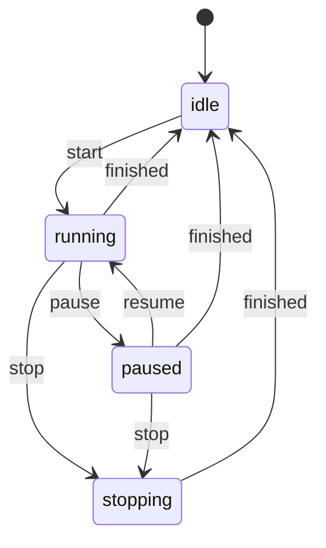
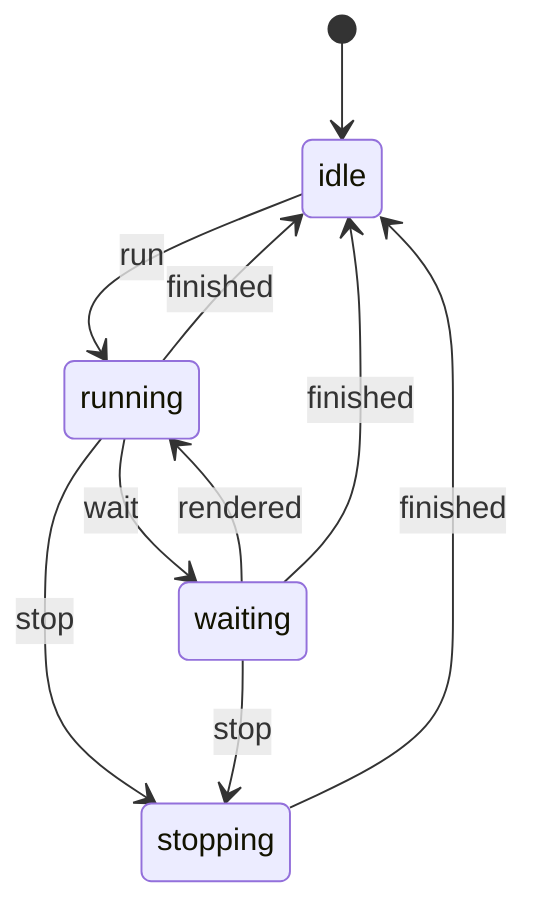
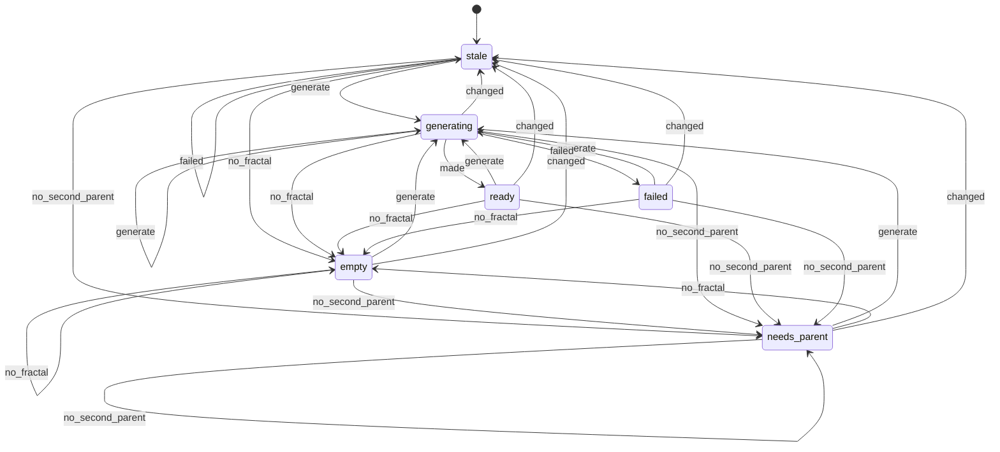
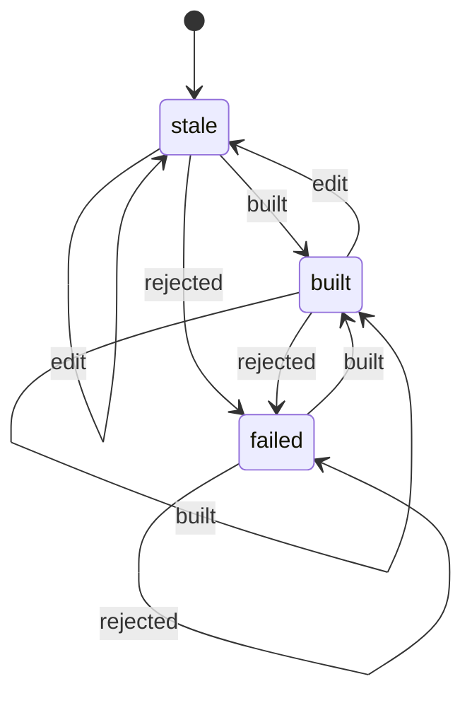
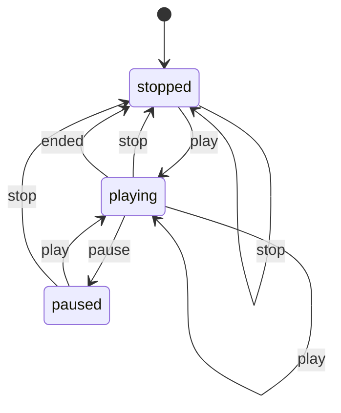
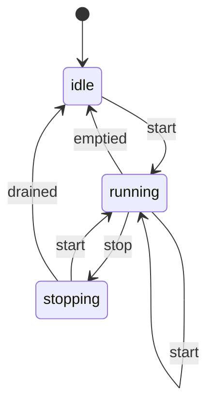

# State machines

A *state machine* is any part of the program that is in one of several states and moves between them on events: a
render is idle, running, paused or stopping; a script is running or waiting for the viewport. When those states live in
scattered flags (`self.job is None`, `self._busy`, whether a button happens to be enabled) the machine is *implicit*:
nothing says which combinations are legal, so illegal ones happen. Two real bugs came from exactly that:

* **Stop, then Pause, hung a render.** The Stop button disabled itself, but Pause stayed enabled; pausing the cancelled
  job cleared the event its thread waits on, and the thread waited forever (quitting then waited a minute for it).
* **A second Run could start before the first one's result arrived.** The Script Editor asked "is the thread alive?",
  which turns false a moment *before* the thread's result is delivered to the window.

## How explicit machines work here

`fractalchemy/machines/` is Qt-free:

* `core.py`: `MachineSpec` (the states — a `StrEnum` —, the initial state, every allowed `(state, event) → state` step,
  a meaning for each state) and `Machine` (one running instance: `state`, `can(event)`, `fire(event)`, `fire_if`,
  `allowed()`, `on_change(listener)`, a short `history`, `describe()`).
* `specs.py`: **every** explicit machine of the application, in one file. Each spec names its owner.

Rules the owners follow:

1. The machine is the single source of truth. Buttons, labels and public properties (`rendering`, `running`,
   `playing`, `needs_build`, `ready` …) are *derived* from `machine.state` / `machine.can(…)`; nothing else stores the
   same fact.
2. UI actions ask `can(event)` before acting, so a button never offers a step the state does not allow.
3. **Illegal events are refused, never fatal, in the application** (`fire` logs a warning and returns False) and
   **fatal in the tests** (`tests/conftest.py` calls `set_strict(True)`, so `fire` raises `IllegalTransition`). A wrong
   sequence therefore fails the test that caused it instead of hiding. Events that are legitimately irrelevant in some
   states use `fire_if`.
4. A state whose owner must *show* it (the Script Editor's *Stopping…*, the render windows' *(stopping)*, the
   Mutate & Breed window's status) takes its text from the state.

Adding a machine: declare the `StrEnum` and the `MachineSpec` in `specs.py` (add it to `ALL`), hold `SPEC.new(label)` in
the owner, derive the UI from it, then run `python tools/state_machines.py` to refresh the section below (a test fails
while it is out of date). The spec validates itself: every state must be reachable from the initial one.

For agents and scripts: every converted owner exposes its machine (`machine`, `run_state`, `offspring_state`,
`build_state`) and a `state` / `job_state` property; `machine.describe()` is a one-line summary and `machine.history`
the last steps taken.

## The explicit machines

This section is generated from `fractalchemy/machines/specs.py` by `tools/state_machines.py`; edit the specs, not this
text.

<!-- BEGIN GENERATED: tools/state_machines.py -->

### Render job

*Owner:* `ui/job_window.py: JobWindowBase (Render Image, Render Animation, Render 3D Image, Render Fragment)` · *starts in* `idle`

The life of one background render started from a job window. Pause is not an event of *stopping*: pausing a cancelled job used to leave its thread waiting for a resume that never came.

| State | Meaning | Accepts |
|---|---|---|
| `idle` | no job: the options can be edited, Start is enabled (when the options are valid) | `start` → `running` |
| `running` | the job's thread is working: Pause and Stop are enabled, the options are locked | `pause` → `paused`, `stop` → `stopping`, `finished` → `idle` |
| `paused` | the job waits between chunks of work: Resume and Stop are enabled | `resume` → `running`, `stop` → `stopping`, `finished` → `idle` |
| `stopping` | Stop was pressed and the job is winding down: nothing else can be done until its thread ends | `finished` → `idle` |

### Script run

*Owner:* `ui/script_editor_window.py: ScriptEditorWindow` · *starts in* `idle`

One run from Run to its result. The run ends when the window has *processed* the result, not when the thread exits, so a second Run cannot start while the first one's result is still on its way.

| State | Meaning | Accepts |
|---|---|---|
| `idle` | no script is running: Run is enabled | `run` → `running` |
| `running` | the script's thread runs against a copy of the fractal: Stop is enabled | `wait` → `waiting`, `stop` → `stopping`, `finished` → `idle` |
| `waiting` | the script called update(wait=True): the main viewport is rendering the intermediate fractal | `rendered` → `running`, `stop` → `stopping`, `finished` → `idle` |
| `stopping` | Stop was pressed: the script ends at its next line (or at once when it waits for input) | `finished` → `idle` |

### Mutate & Breed offspring

*Owner:* `ui/mutation_window.py: MutationWindow` · *starts in* `stale`

What the grid shows. Every regeneration decides between *empty*, *needs_parent* and *generating*; a change in the main window or the options makes the grid *stale*. Adopting a cell is not a state: it is one undoable edit followed by a regeneration.

| State | Meaning | Accepts |
|---|---|---|
| `stale` | the parent or the options changed: new offspring are made once the edits pause (or when the window is shown); results still arriving for the old parent are shown meanwhile | `generate` → `generating`, `no_fractal` → `empty`, `no_second_parent` → `needs_parent`, `changed` → `stale`, `made` → `stale`, `failed` → `stale` |
| `empty` | the main window shows no fractal: there is nothing to mutate | `generate` → `generating`, `no_fractal` → `empty`, `no_second_parent` → `needs_parent`, `changed` → `stale` |
| `needs_parent` | the Breed tab is showing and there is no second parent (B) yet | `generate` → `generating`, `no_fractal` → `empty`, `no_second_parent` → `needs_parent`, `changed` → `stale` |
| `generating` | offspring are being made on the thread pool | `generate` → `generating`, `no_fractal` → `empty`, `no_second_parent` → `needs_parent`, `changed` → `stale`, `made` → `ready`, `failed` → `failed` |
| `ready` | eight offspring are shown: click one (or press its number) to make it the fractal | `generate` → `generating`, `no_fractal` → `empty`, `no_second_parent` → `needs_parent`, `changed` → `stale` |
| `failed` | making offspring raised an error (shown across the grid) | `generate` → `generating`, `no_fractal` → `empty`, `no_second_parent` → `needs_parent`, `changed` → `stale` |

### Fragment build

*Owner:* `ui/fragments/document.py: FragDocument` · *starts in* `stale`

Replaces the two flags `needs_build` / `build_failed_last` (whose fourth combination was impossible); both remain as properties derived from the state.

| State | Meaning | Accepts |
|---|---|---|
| `stale` | the source, a lock or a build option changed since the shown program was built: *Build needed* | `edit` → `stale`, `built` → `built`, `rejected` → `failed` |
| `built` | the shown program is the current source | `edit` → `stale`, `built` → `built`, `rejected` → `failed` |
| `failed` | the last build was rejected (preprocessor, translator or driver): *Build failed*; the previous program, if any, keeps rendering | `edit` → `failed`, `built` → `built`, `rejected` → `failed` |

### Animation playback

*Owner:* `ui/animation_playback.py: Playback` · *starts in* `stopped`

Replaces `QTimer.isActive()` plus a `_session` flag; `playing` and `in_session` remain as derived properties.

| State | Meaning | Accepts |
|---|---|---|
| `stopped` | no playback session: Play starts one from the playhead | `play` → `playing`, `stop` → `stopped` |
| `playing` | the playhead advances with the wall clock (frames are dropped when the engine is slower) | `play` → `playing`, `pause` → `paused`, `stop` → `stopped`, `ended` → `stopped` |
| `paused` | the session holds its place: Play resumes, Stop returns to where playback started | `play` → `playing`, `stop` → `stopped` |

### Render queue

*Owner:* `ui/fragments/render_queue.py: RenderQueueWindow` · *starts in* `idle`

The queue as a whole (each entry has its own waiting / rendering / done / failed / stopped label). Replaces a `_running` flag whose meaning depended on whether a job object happened to exist.

| State | Meaning | Accepts |
|---|---|---|
| `idle` | nothing renders: entries can be added, removed and started | `start` → `running` |
| `running` | the waiting entries render one after another | `start` → `running`, `stop` → `stopping`, `emptied` → `idle` |
| `stopping` | Stop was pressed: the current entry is cancelled and the rest stay waiting | `start` → `running`, `drained` → `idle` |

<!-- END GENERATED -->

## Inventory: every lifecycle in the program, and what was decided

The search covered every module for the usual markers of an implicit machine — boolean state flags (`_busy`, `_running`,
`_pending`, `_stale`, `_paused`, `_waiting`, `_dragging` …), nullable job / thread references, `state` / `mode` / `phase`
fields, generation counters and load tickets — and then read each hit. The decision rule: **make a machine explicit
where the implicit form can reach an illegal combination, or where the user needs to see the state; leave it alone where
the lifecycle is already correct by construction**, because a rewrite there would add ceremony and risk without a gain
for users, developers or agents.

### Made explicit (the machines above)

| Where | Was encoded as | Why it was converted |
|---|---|---|
| `ui/job_window.py` `JobWindowBase` and its four render windows (Render Image, Render Animation, Render 3D Image, Render Fragment) | `self.job`, `job.paused`, the Stop button's enabled state (the only record of *stopping*), `_showing_result`, an ad-hoc `pause_button.setEnabled(False)` while ffmpeg encodes | **Bug**: Stop → Pause hung the render thread. Now *stopping* accepts nothing but `finished`, the buttons are derived, ffmpeg's phase is a `_can_pause_now` hook, and the phase line says *(stopping)*. `RenderControl.pause` also ignores a cancelled job (defence in depth). |
| `ui/script_editor_window.py` `ScriptEditorWindow` | `runner.running` (thread alive), the actions' enabled states, `_waiting` | **Race**: a run could start before the previous result was processed. Now the run ends when the window handles its result; *waiting* and *stopping* are states with their own labels. |
| `ui/mutation_window.py` `MutationWindow` | `_stale`, whether `offspring` is empty, a generation counter | Six situations (stale, empty, needs parent B, generating, ready, failed) were guessed from two facts; the grid and a permanent status label now say which one it is. |
| `ui/fragments/document.py` `FragDocument` | `needs_build` and `build_failed_last` (one of four combinations impossible) | Three states, two flags: now one state; both flags remain as derived properties and the signal is unchanged. |
| `ui/animation_playback.py` `Playback` | `QTimer.isActive()` and `_session` | Stopped / playing / paused were inferred from a timer; now named, with `playing` / `in_session` derived. |
| `ui/fragments/render_queue.py` `RenderQueueWindow` | `_running` plus whether a job object exists | *Stopping* existed only as "`_running` is false but a job is still there"; now it is a state, and Stop is disabled while it lasts. |

### Left as they are (and why)

| Where | The lifecycle | Encoded as | Why it stays |
|---|---|---|---|
| `render/service.py` `RenderService` | a priority scheduler: queued → running → finished / failed / paused (pre-empted, resumed later) per render slot | a queue, `_running_key`, `_superseded`, `_paused` under a `threading.Condition` | Per-slot state across two threads, guarded by one lock and covered by the render tests; an enum per slot would add locking, not safety. |
| `ui/fractal_viewport.py` (main viewport), `ui/live_preview.py` (Transform Editor / Animation previews), `ui/grid_renderer.py`, `ui/three_d/viewport.py`, `ui/fragments/render_driver.py` | coalescing render loops: *idle → busy → busy with a newer request waiting*, interactive vs full resolution | generation counters / tokens, a pending flag, settle and throttle timers | Correct by construction: every result carries its generation and stale ones are dropped, so no combination is illegal. Heavily tested. |
| `ui/formula_session.py` `FormulaSession` | debounced compile: idle → waiting for the pause → compiling ⇄ compiling with a newer edit | debounce timer, `_running` generation, `_pending`; already exposes `compiling` and `state_changed` | The same latest-wins pattern, with a public state signal already. |
| `ui/three_d/window.py` (mesh / export jobs), `ui/fragments/mesh_export_dialog.py`, `batch_dialog.py`, `de_slice_dialog.py`, `ui/formula_drawer.py` (probe), `ui/random_batch_window.py` | a single job slot: idle ⇄ busy (cancel ends it early) | `self._job is None` / `_busy` | Two states, one owner, no pause: the encoding *is* the machine, and no illegal combination exists. |
| `ui/file_actions_base.py` load tickets, `library/controller.py` scan counter, `ui/thumbnails.py` pending renders | supersession and counting, not lifecycles | tickets, counters, a dict of pending keys | Latest-wins tokens and a "busy while > 0" counter; nothing to transition. |
| `widgets/node_bar.py`, `widgets/triangle_view.py`, `widgets/timeline.py`, `widgets/curve_editor.py`, `ui/fragments/viewport*.py`, `ui/three_d/viewport.py` | mouse gestures: press → drag → release | `_dragging`, `DragState` (already an explicit value in `fractal/triangle_drag.py`) | Local to one widget; Qt delivers press / move / release in order and every release resets. |
| `widgets/silent.updating` users, `ui/gradient_link.py` `_syncing`, `ui/mutation_window.py` `_adopting`, `ui/random_batch_window.py` / `ui/fragments/composer_dialog.py` `_loading` | re-entrancy guards | booleans set around a block (mostly the `updating()` context manager) | Not lifecycles: they only silence feedback while code fills widgets. |
| `ui/fractal_document.py`, `ui/document.py` (gradient), `ui/animation_document.py` | *modified*, undo coalescing, the gradient's pending slider adjustments | `_modified`, `_last_edit`, `_base` | One owner each, transitions only through the documents' own methods, covered by the undo tests. |
| `widgets/theming.py` `ThemeManager` | System vs a catalogue theme | the applied name | Any theme can follow any other; nothing is illegal. |
| `ui/fragments/window.py` pause-when-hidden, fullscreen; `ui/three_d/window.py` *Follow*; `ui/formula_editor_panels.py` sweep | two-state toggles with a timer | a flag | A toggle is already explicit. |
| `fragments/controllers.py` (MIDI running status), `ui/fragments/controller_input.py` (learn mode, reader thread) | a byte-protocol parser; learn on / off | `_status`, `_pending` bytes; `_stop` | The parser *is* an explicit protocol machine (MIDI's running status), Qt-free and tested. |
| `ui/script_runner.py` `_QtHost` | the script thread's request / answer handshake | a queue | The thread side of the Script Editor's machine; its states are now the window's *running* / *waiting*. |
| `ui/render_progress.py`, `render/final_engine.py` phases | progress reports (rendering, filtering, saving, done, cancelled) | phase strings | Reports from the worker for display, not state that drives logic. |
